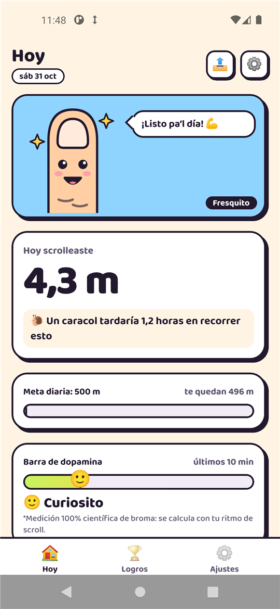
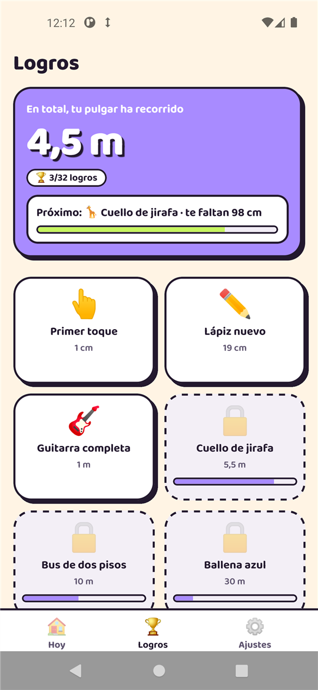
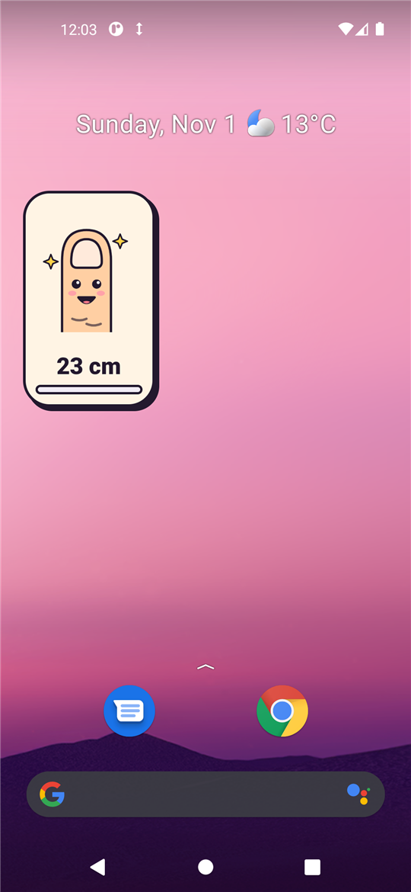
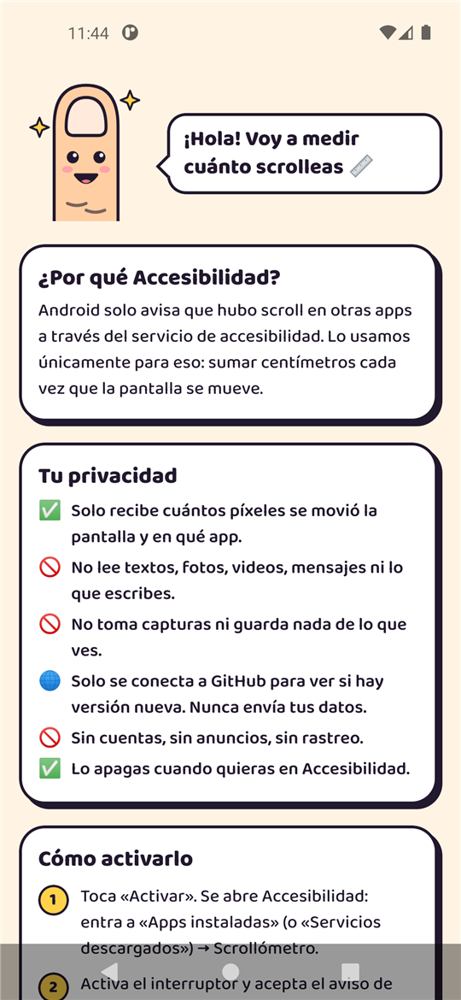

<div align="center">


# Scrollómetro

**¿Cuánto mide tu scroll?** 📏

Una app para Android que cuenta en centímetros, metros y kilómetros todo lo que tu pulgar recorre en TikTok, Instagram, YouTube y compañía. Con mascotas que sufren contigo, logros absurdos y una barra de dopamina 100% científica de broma.

[](https://github.com/foxen2005/scrollometro/releases/latest/download/Scrollometro.apk)

[](https://foxen2005.github.io/scrollometro/)
[](#instalación)
[](https://expo.dev)
[](LICENSE.md)

&nbsp;
&nbsp;
&nbsp;


</div>

---

## Instalación

1. Descarga [`Scrollometro.apk`](https://github.com/foxen2005/scrollometro/releases/latest/download/Scrollometro.apk) desde el teléfono y ábrelo.
2. Abre la app: la bienvenida te explica todo y te lleva a **Accesibilidad → Apps instaladas → Scrollómetro → activar**.
3. Si Android dice **«Controlado por la configuración restringida»**: Info de la app → menú **⋮** → **Permitir ajustes restringidos**, y vuelve a activarlo.

Requiere Android 7.0 o superior.

> **¿Por qué Play Protect se pone nervioso?** Scrollómetro usa el servicio de **Accesibilidad**, que es el único camino que da Android para saber que hubo scroll en otras apps. Es el mismo permiso que usan las apps de fraude, así que Google revisa con lupa toda app que lo pide y no viene de la Play Store. Por eso todo el código está aquí, abierto: puedes ver exactamente qué hace y qué no ([Privacidad](#privacidad)).

**Actualizaciones:** la app revisa este repositorio al abrirse y, si hay versión nueva, te la ofrece con un toque. Android solo la instala si viene firmada con la misma llave que la que ya tienes.

> Si tenías la 0.1 o la 0.2 (firmadas con la llave de prueba), desinstálalas una vez antes de instalar la 0.3. Desde la 0.3 todo se actualiza solo.

## Qué hace

- **Mide de verdad**: suma cuántos píxeles se movió la pantalla en cada scroll y los convierte a centímetros con la densidad real de tu pantalla (`ydpi`).
- **Notificación fija** con el total del día, tus apps más scrolleadas y una frase de tu mascota.
- **Tres mascotas** con cuatro estados según lo que llevas: el pulgar (fresquito → zombie 🧟), el caracol (impresionado → llorando en baba) y el cerebro (fresco → frito en sartén 🍳).
- **Equivalencias absurdas**: canchas de fútbol, micros en fila, Gran Torre Santiago, el Everest, el camino a Puerto Montt, lo que tardaría un caracol…
- **Barra de dopamina** según tu ritmo de los últimos 10 minutos. Es de broma, no mide nada de tu cerebro.
- **32 logros**, desde «Primer toque» (1 cm) hasta «Hasta la Luna» (384.400 km).
- **Meta diaria** que te reta cuando te pasas.
- **Widgets** 2×2 y 4×2 para el escritorio.
- **Tarjeta para historias** (1080×1920) para presumir o avergonzarte.
- **Detalle por app**: TikTok, Instagram, YouTube, X… cada una con su distancia.

## Privacidad

Scrollómetro ve cuándo se mueve tu pantalla, así que esto importa. Lo que hay, verificable en el código:

| | Dónde |
|---|---|
| **No lee lo que hay en pantalla.** El servicio se declara con `canRetrieveWindowContent="false"`: Android no le entrega textos, imágenes ni nada del contenido. | [`scroll_tracker_service.xml`](modules/scroll-tracker/android/src/main/res/xml/scroll_tracker_service.xml) |
| **Solo escucha dos tipos de evento**: «hubo scroll» y «cambió la pantalla». Del evento usa el nombre de la app y cuántos píxeles se movió. | [`ScrollAccessibilityService.kt`](modules/scroll-tracker/android/src/main/java/cl/digitalfox/scrolltracker/ScrollAccessibilityService.kt), [`ScrollStore.kt`](modules/scroll-tracker/android/src/main/java/cl/digitalfox/scrolltracker/ScrollStore.kt) |
| **Todo queda en tu teléfono**: totales por día y por app en `SharedPreferences`. Sin cuentas, sin servidor, sin analítica, sin anuncios. | `ScrollStore.kt` |
| **Su única conexión a internet** es para leer el último release público de este repo y descargar el APK si hay versión nueva. No envía ningún dato tuyo. | [`src/lib/updates.ts`](src/lib/updates.ts), [`Updater.kt`](modules/scroll-tracker/android/src/main/java/cl/digitalfox/scrolltracker/Updater.kt) |
| **Actualizaciones verificadas**: solo se descargan desde `https://github.com/`, se revisa que el APK sea de esta app y de una versión mayor, y Android lo rechaza si no viene firmado con la misma llave. | `Updater.kt` |
| **Permisos mínimos**: Accesibilidad, notificaciones, internet (solo GitHub) e instalar actualizaciones. Se bloquean explícitamente dibujar sobre otras apps, almacenamiento y vibración. | [`app.json`](app.json) |

Lo apagas cuando quieras en **Ajustes → Accesibilidad → Scrollómetro**.

## Cómo mide

Android avisa a los servicios de accesibilidad cada vez que una vista hace scroll. Scrollómetro usa, en orden:

1. **Delta** (`scrollDeltaY`, Android 9+): los píxeles exactos que se movió. Es lo más preciso y lo que usan Instagram y la mayoría de las apps.
2. **Posición** (`scrollY`): la diferencia con la posición anterior, para vistas que informan dónde están y no cuánto se movieron.
3. **Índice** (`fromIndex`): en feeds que pasan de a una pantalla, cada elemento ≈ alto de pantalla ÷ elementos visibles.

El scroll horizontal (carruseles, historias) no cuenta. Los píxeles se pasan a cm con `px ÷ ydpi × 2,54`. En **Ajustes → Avanzado → Eventos crudos** puedes ver cómo se midió cada evento.

## Desarrollo

```bash
# Solo para uso personal y para revisar el código (ver Licencia)
git clone https://github.com/foxen2005/scrollometro.git
cd scrollometro
npm install
npx expo prebuild -p android
cd android && ./gradlew assembleRelease -PreactNativeArchitectures=arm64-v8a
```

El servicio de accesibilidad es código nativo (módulo Expo local), así que **no corre en Expo Go**: hay que compilar el APK. Requiere Node 20+, JDK 17+ y el SDK de Android.

- **Windows**: CMake 3.22 (el que viene por defecto) falla con rutas de más de 260 caracteres. El plugin [`withCmakeVersion`](plugins/withCmakeVersion.js) usa CMake 3.31.6: `sdkmanager --install "cmake;3.31.6"`.
- **Firma**: el build release usa la llave propia si existe `SCROLLOMETRO_STORE_FILE` en `~/.gradle/gradle.properties` ([`withReleaseSigning`](plugins/withReleaseSigning.js)); si no, cae a la llave de prueba. Los releases oficiales van siempre con la llave propia.
- **Publicar**: [`scripts/release.ps1`](scripts/release.ps1) `-Version X.Y.Z -Notes "…"` sube la versión, compila, verifica la firma y crea el release con `Scrollometro.apk`.
- **Mascotas del widget y logo**: [`scripts/export-mascots.mjs`](scripts/export-mascots.mjs) y [`scripts/export-logo.mjs`](scripts/export-logo.mjs) generan los PNG desde los mismos SVG de la app.

### Arquitectura

```
App.tsx                      — pestañas, bienvenida, compartir, consulta cada 1 s
src/
├── screens/                 — Hoy, Logros, Ajustes, Bienvenida, Compartir
├── components/              — Mascot (SVG animado), UpdateCard, ui (tarjetas, botones)
└── lib/
    ├── content.ts           — formatos, equivalencias, niveles de dopamina, 32 logros
    ├── mascots.ts           — las mascotas en SVG (3 × 4 estados)
    └── updates.ts           — búsqueda e instalación de versiones desde GitHub
modules/scroll-tracker/      — módulo nativo (Kotlin)
├── ScrollAccessibilityService.kt — recibe los eventos de scroll
├── ScrollStore.kt           — px → cm, totales, histórico, dopamina, notificación
├── ScrollWidgets.kt         — widgets 2×2 y 4×2
├── Updater.kt               — descarga + instalador por sesión
└── ScrollTrackerModule.kt   — puente con JS
maqueta/index.html           — la maqueta original, con animación
docs/                        — sitio (GitHub Pages)
```

## Licencia

El código es **visible, pero no libre**: [PolyForm Strict 1.0.0](LICENSE.md). Puedes leerlo, auditarlo y usar la app para fines personales y no comerciales; **no** puedes modificarla, redistribuirla ni publicar copias o versiones derivadas. El nombre, el logo, el ícono y las mascotas quedan con todos los derechos reservados ([NOTICE](NOTICE.md)).

¿Una idea, un arreglo o quieres colaborar? Abre un issue.

Hecho en Chile por [Digital Fox](https://github.com/foxen2005). Idea, logros y lentes pixelados: Jean.
